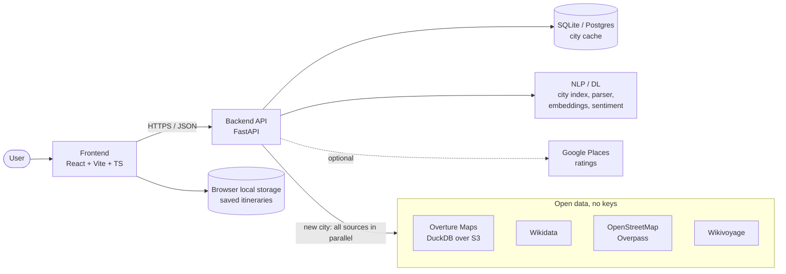

# TripAura

**Day-by-day trip plans for any city in the world, built from free open map data.**

[Open the app](https://trip-aura-cr.vercel.app/) · [Releases](https://github.com/ranjanvrma/trip-aura/releases)


Give it a city and where you're staying, plus your dates, budget, interests, diet, transport and pace, or describe the trip in one sentence. It plans every day: sights in an order that saves walking, with opening hours respected; meals that fit your diet; breaks; a transport leg for every move; and a budget that keeps real prices apart from estimates.

> **Working on this repo (human or AI)?** Read [HANDOFF.md](HANDOFF.md) first: it has the current state, decisions and next steps, and must be updated in every commit. Then read [CLAUDE.md](CLAUDE.md), the working guide: folder map, commands, coding and design rules, known pitfalls, and the checklist to run before calling a task done.

## What it does

- **Any city, no API key.** Places come from Overture Maps, Wikidata, OpenStreetMap and Wikivoyage, loaded on demand and cached for 30 days. Over 34,000 cities resolve from an offline index.
- **Plans that hold together.** Every place gets a 0 to 5 fit score with reasons. Each day starts from its strongest sight and the stops are reordered to cut travel (greedy order, then 2-opt), with meals, breaks and opening hours fitted in.
- **Your kind of trip.** Choose how to spend the budget: lowest cost (cheaper meals, free sights, walking and transit), mid-range, or premium (better restaurants, faster rides). The budget stays the ceiling either way.
- **Food that fits.** Vegetarian, vegan, Jain, eggetarian and non-veg filters, and local dishes only when reviews or a travel guide back them up.
- **Honest numbers.** Every rating and price says where it came from, estimates are labelled, and the fit score never uses outside ratings.
- **Any currency, local one first.** Plan in any of 150 currencies. Pick a city and the form offers the one used there (EUR for Lisbon, PKR for Karachi) in one click. Rates come from the European Central Bank where it publishes them, and from ExchangeRate-API otherwise.
- **Type it instead.** A one-sentence description fills in the whole form; city and interest matching handle typos.
- **Finds your hotel.** The hotel search stays in your destination and matches a word anywhere in a name, so "inn" finds Holiday Inn and Golden Inn, with places to stay listed first.
- **Made to be used.** A lit 3D globe that turns to your destination, a planner that asks one question at a time while a boarding pass fills in beside it, and small demos on the home page (route ordering, budget styles, pace) that really run. Each plan opens as a ticket with a ribbon of how every day is spent and charts of where the budget goes.
- **Take it with you.** Download any plan as a PDF: a cover with the totals and budget, a page per day with times, stops, rides and costs, then food, notes and sources.
- **Dark or light.** A night look by default, with a light theme one click away; the choice is remembered in your browser.
- **No account.** Plans are saved in your browser on this device. They do not sync, and clearing site data removes them.

## Architecture



**How a trip request flows:**
1. **Understand.** The form, or the NLP parser for a typed description, gives the city, dates, budget and preferences. The city resolves from an offline index of about 34k cities.
2. **Load the city.**
   - **First visit:** Overture, Wikidata, OpenStreetMap (25 s cap) and Wikivoyage are fetched **in parallel**, merged into one list of places, then cached in Postgres for 30 days. This takes about 30–60 s.
   - **Later visits:** read from the cache in about 1–2 s.
3. **Score.**
   - Every place gets a 0–5 suitability score: interests 30%, budget 20%, distance 20%, transport 10%, time 10%, pace 10%.
   - Typo correction and semantic embeddings help match custom interests.
4. **Schedule.**
   - Each day is built around its best sight, ordered to minimise travel, checked against opening hours, and given meals near each stop.
   - Each stop then gets a transport leg with alternatives.
5. **Cost and explain.** Fares, meals and fees come from a country price index plus currency conversion. Estimates and verified amounts are kept apart, and over-budget plans get savings suggestions.

| Folder | What lives there |
|---|---|
| `backend/app/engines/` | Pure planning logic: itinerary, scoring, food, transport, budget, costs |
| `backend/app/providers/` | Data sources behind one interface: `open/` (worldwide), `google/` (optional), `mock/` (Jaipur demo) |
| `backend/app/nlp/` | City index, trip-text parser, interests, embeddings, sentiment |
| `backend/app/services/` | Orchestration (`itinerary_service.py`), FX, Google enrichment |
| `backend/app/routers/` | REST API |
| `frontend/src/pages/` | Planner (home), trip, saved trips, legal, 404 |
| `frontend/src/components/` | `home/` (departure board, try-it demos), `planner/` (five-step planner, boarding pass, describe box, progress), `trip/` (ticket, day cards, ribbon, budget, places, PDF layout), `globe/` (three.js Earth), `map/`, `layout/`, `ui/` (dropdown, stepper, sheet...), `art/` |
| `frontend/src/lib/` | Saved trips in local storage, data cache, toasts, page titles, motion helpers |
| `.github/` | CI (tests + build), Dependabot, PR template |

**Tech stack:**

| Layer | Technology |
|---|---|
| Frontend | React 18, TypeScript, Vite, three.js (globe), Leaflet or Google Maps, Motion, GSAP |
| Backend | FastAPI, Pydantic, SQLAlchemy |
| Data | DuckDB, Overture Maps, Wikidata, OpenStreetMap, Wikivoyage, GeoNames |
| NLP / ML | rapidfuzz, fastembed (ONNX `bge-small-en-v1.5`) |
| Infrastructure | SQLite locally, Postgres in production for city cache; browser local storage for saved itineraries; Vercel + Azure deployment |

## Quick start

```bash
cd backend
python -m venv .venv
.venv/Scripts/python -m pip install -r requirements.txt  # macOS: .venv/bin/python -m pip
cp .env.example .env
.venv/Scripts/python -m uvicorn app.main:app --reload --port 8000
```

In a second terminal, from the repository root:

```bash
cd frontend
npm ci
npm run dev
```

Open <http://localhost:5173>, pick a city (e.g. "Lisbon") and a hotel, then generate. API docs are at <http://127.0.0.1:8000/docs>.

**Tests:**
- Backend: `cd backend && .venv/Scripts/python -m pytest -q` (131 tests, fully offline)
- Frontend: `cd frontend && npm run build`

## Configuration

Everything works without keys. The main settings, set in `backend/.env` (full list in `backend/app/core/config.py`):

| Variable | Default | Purpose |
|---|---|---|
| `DATA_MODE` | `open` | `open` (worldwide), `live` (Google only), `mock` (Jaipur demo for tests) |
| `DATABASE_URL` | local SQLite | Postgres URL in production (Neon `postgres://...` works as-is) |
| `CORS_ORIGINS` | localhost | Frontend URL(s) allowed to call the API |
| `OPEN_USER_AGENT` | project URL | Must contain a contact URL, otherwise Wikimedia returns 403 |
| `GOOGLE_MAPS_API_KEY` | empty | Optional: adds Google ratings to planned places |
| `SEMANTIC_ENABLED` | `true` | Local embedding model for semantic matching |
| `APP_ENV` | `development` | `production` turns off API docs by default |

Frontend: leave `VITE_API_BASE_URL` empty and use the Vite `/api` proxy locally. In production, Vercel rewrites `/api/*` to Azure. No email provider, account, or sign-in configuration is needed. Saved itineraries are kept in browser local storage on the current device.

## Project status

**The public app is deployed.** The [TripAura website](https://trip-aura-cr.vercel.app/) is hosted on Vercel, and its backend runs on Azure Container Apps. Website-to-API connectivity and CORS were last confirmed on 2026-11-10. That check covered backend image `c55f12c`; the latest repository revision may require a separate deployment check. Backend changes on `main` trigger the Azure deployment workflow when its GitHub Actions configuration is enabled.

The planner and API are live. Itineraries are generated by the backend and saved only in the user's browser. Google Maps enrichment is optional and is not configured; the app uses open data by default.

See [HANDOFF.md](HANDOFF.md#8-deployment-status) for deployment details and outstanding follow-up work.

## API

| Method | Path | Purpose |
|---|---|---|
| POST | `/api/trips/preview` | Generate an itinerary without saving it on the server |
| GET | `/api/geo/cities?q=` · `/api/geo/addresses?q=&lat=&lng=&city=` | City and hotel autocomplete |
| POST | `/api/nlp/parse-trip` | Free-text description → form fields |
| GET | `/api/meta/status` · `/api/health` | Configuration status · health check |

## Contributing

1. **Catch up:** fetch and review the latest changes, read [HANDOFF.md](HANDOFF.md), and skim `git log --oneline -15`.
2. **One-time setup per clone:** `git config core.hooksPath .githooks`. This hook blocks commits that don't update `HANDOFF.md`; for trivial commits, bypass with `SKIP_HANDOFF=1 git commit ...`.
3. **Commit locally:** every change updates `HANDOFF.md` (status, decisions, change log). Never commit secrets. Do not push; push the commits yourself when ready.
4. **GitHub credit:** commit with the email on your GitHub account so you appear in Contributors.

## Authors

- **Ranjan Verma**: [GitHub](https://github.com/ranjanvrma) · [LinkedIn](https://www.linkedin.com/in/ranjan-vrma/)
- **Chinmay Dahiya**: [GitHub](https://github.com/dahiyachinmay15) · [LinkedIn](https://www.linkedin.com/in/chinmaydahiya/)

Data © OpenStreetMap contributors (ODbL), Overture Maps Foundation, Wikidata (CC0), Wikivoyage (CC BY-SA), GeoNames (CC BY). Every itinerary lists its sources.
