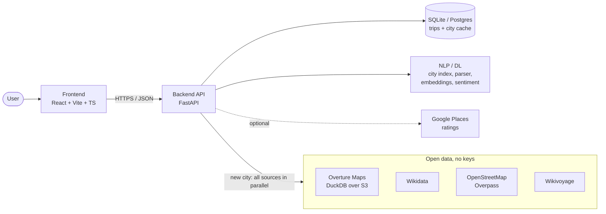

# TripAura

**AI-powered, day-by-day travel itineraries for any city in the world, built from free open data.**


Tell TripAura where you're staying, where you're going, your budget, interests, diet, transport and pace (or describe the trip in one sentence). It plans every day:
- sights in a sensible order, with opening hours respected
- breakfast, lunch and dinner that fit your diet
- rest breaks and transport for every leg
- a budget that separates real prices from estimates

> **Working on this repo (human or AI)?** Read [HANDOFF.md](HANDOFF.md) first. It has the current state, decisions and next steps, and must be updated in every commit.

## Features

- **Any city, no API key:** places from Overture Maps, Wikidata, OpenStreetMap and Wikivoyage, loaded on demand and cached for 30 days.
- **Smart planning:**
  - a personal 0–5 fit score for every place, with reasons
  - travel-minimising order (day anchor, then greedy ordering, then 2-opt)
  - pace-aware days with rest breaks
- **Food that fits:** vegetarian, vegan, Jain, eggetarian and non-veg filters, plus local dishes backed by review or guidebook evidence.
- **Honest numbers:** every rating and price shows its source, estimates are labelled, and the fit score is kept separate from external ratings.
- **NLP / AI:**
  - city autocomplete with typo handling
  - a "describe your trip" box that fills the form
  - typo-tolerant interests
  - semantic matching with a local embedding model
  - review sentiment
- **Budget and live mode:** savings suggestions and auto "fit to budget"; live location with next-stop distance and better-transport alerts.

## Architecture



**How a trip request flows:**
1. **Understand.** The form, or the NLP parser for a typed description, gives the city, dates, budget and preferences. The city resolves from an offline index of about 34k cities.
2. **Load the city.**
   - **First visit:** Overture, Wikidata, OpenStreetMap (25 s cap) and Wikivoyage are fetched **in parallel**, merged into one list of places, then cached in Postgres for 30 days. This takes about 30–60 s.
   - **Later visits:** read from the cache in about 1–2 s.
3. **Score.**
   - Every place gets a 0–5 suitability score: interests 30%, budget 20%, distance 20%, transport 10%, time 10%, pace 10%.
   - Typo correction and semantic embeddings help match custom interests.
4. **Schedule.**
   - Each day is built around its best sight, ordered to minimise travel, checked against opening hours, and given meals near each stop.
   - Each stop then gets a transport leg with alternatives.
5. **Cost and explain.** Fares, meals and fees come from a country price index plus currency conversion. Estimates and verified amounts are kept apart, and over-budget plans get savings suggestions.

| Folder | What lives there |
|---|---|
| `backend/app/engines/` | Pure planning logic: itinerary, scoring, food, transport, budget, costs |
| `backend/app/providers/` | Data sources behind one interface: `open/` (worldwide), `google/` (optional), `mock/` (Jaipur demo) |
| `backend/app/nlp/` | City index, trip-text parser, interests, embeddings, sentiment |
| `backend/app/services/` | Orchestration (`itinerary_service.py`), FX, Google enrichment, live location |
| `backend/app/routers/` | REST API |
| `frontend/src/` | Pages, components (form, day cards, map, budget), typed API client |
| `.github/` | CI (tests + build), Dependabot, PR template |

**Tech stack:**

| Layer | Technology |
|---|---|
| Frontend | React 18, TypeScript, Vite, Leaflet |
| Backend | FastAPI, Pydantic, SQLAlchemy |
| Data | DuckDB, Overture Maps, Wikidata, OpenStreetMap, Wikivoyage, GeoNames |
| NLP / ML | rapidfuzz, fastembed (ONNX `bge-small-en-v1.5`) |
| Infrastructure | SQLite locally, Postgres in production; GitHub Actions CI (hosting planned, see below) |

## Quick start

```bash
cd backend
python -m venv .venv
.venv/Scripts/python -m pip install -r requirements.txt  # macOS: .venv/bin/python -m pip
cp .env.example .env
.venv/Scripts/python -m uvicorn app.main:app --reload --port 8000
```

In a second terminal, from the repository root:

```bash
cd frontend
npm ci
npm run dev
```

Open <http://localhost:5173>, pick a city (e.g. "Lisbon") and a hotel, then generate. API docs are at <http://127.0.0.1:8000/docs>.

**Tests:**
- Backend: `cd backend && .venv/Scripts/python -m pytest -q` (112 tests, fully offline)
- Frontend: `cd frontend && npm run build`

## Configuration

Everything works without keys. The main settings, set in `backend/.env` (full list in `backend/app/core/config.py`):

| Variable | Default | Purpose |
|---|---|---|
| `DATA_MODE` | `open` | `open` (worldwide), `live` (Google only), `mock` (Jaipur demo for tests) |
| `DATABASE_URL` | local SQLite | Postgres URL in production (Neon `postgres://...` works as-is) |
| `CORS_ORIGINS` | localhost | Frontend URL(s) allowed to call the API |
| `OPEN_USER_AGENT` | project URL | Must contain a contact URL, otherwise Wikimedia returns 403 |
| `GOOGLE_MAPS_API_KEY` | empty | Optional: adds Google ratings to planned places |
| `SEMANTIC_ENABLED` | `true` | Local embedding model for semantic matching |

Frontend: `VITE_API_BASE_URL` is the backend URL in production. Leave it empty locally, where the Vite proxy is used.

## Project status

**Done (Nov 2026):**
- **Planning engines:** itinerary (day anchor, greedy ordering, 2-opt, opening hours, meals, rests), 0–5 suitability scoring, diet-aware food with evidence-based dishes, transport legs with alternatives, budget with savings and fit-to-budget.
- **Worldwide open data:** Overture, Wikidata, OpenStreetMap and Wikivoyage, loaded in parallel and cached per city. A first trip to a new city takes about 37 s for Rome, down from 245 s; a cached trip takes about 1 s.
- **NLP / AI:** city autocomplete, address suggestions, "describe your trip" parser, typo-tolerant and semantic interests, review sentiment.
- **Product features:** live location updates, worldwide cost model with 31 currencies, honest source labels.
- **Quality:** 112 offline tests, CI on every push, a HANDOFF document kept current by a commit hook.
- **Deployment method worked out:** a trial run proved the free setup below works end to end. It was then removed on purpose so the real deployment starts clean.

**Next:** deploy with the plan below, re-running every test on deploy day, then a premium animated UI redesign.

## Deployment plan (not deployed yet)

We now know how to deploy. This free setup needs no credit card and has been proven in a trial run:

| Part | Service | Notes |
|---|---|---|
| Frontend | **Vercel** (Hobby, free) | Root directory `frontend`; set `VITE_API_BASE_URL` to the backend URL |
| Backend | **Azure Container Apps** via **Azure for Students** (college email, no card) | 1 vCPU / 2 GiB, scale to zero, max 1 replica, no paid log workspace. The monthly free allowance covers about 50 active hours; the $100 student credit is only a backup, and the account can't be billed |
| Image | **GitHub Container Registry** | Built by GitHub Actions; public images are free |
| Database | **Neon** Postgres (free) | Pooled connection string as `DATABASE_URL` |

What we learned:
- **Memory:** the backend needs about 750 MB of RAM. Free 512 MB tiers (Render, Koyeb) are too small.
- **Other hosts:** Hugging Face Docker is now paid; Modal and Oracle need a card.
- **Regions:** student subscriptions only allow some regions. Ours allowed Central India and East Asia, not East US, so pick from the allowed list.
- **User-Agent:** `OPEN_USER_AGENT` must contain a contact URL, or Wikimedia returns 403.

The exact steps, how to restore the deployment files from git history, and the full test checklist for deploy day are in [HANDOFF.md](HANDOFF.md#8-deployment-status).

## API

| Method | Path | Purpose |
|---|---|---|
| POST | `/api/trips` · `/api/trips/preview` | Generate a trip (saved / not saved) |
| GET, DELETE | `/api/trips`, `/api/trips/{id}` | List, read, delete saved trips |
| POST | `/api/trips/{id}/regenerate` · `/api/trips/{id}/live` | Re-plan · live position updates |
| GET | `/api/geo/cities?q=` · `/api/geo/addresses?q=` | City and hotel autocomplete |
| POST | `/api/nlp/parse-trip` | Free-text description → form fields |
| GET | `/api/meta/status` · `/api/health` | Configuration status · health check |

## Contributing

1. **Catch up:** fetch and review the latest changes, read [HANDOFF.md](HANDOFF.md), and skim `git log --oneline -15`.
2. **One-time setup per clone:** `git config core.hooksPath .githooks`. This hook blocks commits that don't update `HANDOFF.md`; for trivial commits, bypass with `SKIP_HANDOFF=1 git commit ...`.
3. **Commit locally:** every change updates `HANDOFF.md` (status, decisions, change log). Never commit secrets. Do not push; push the commits yourself when ready.
4. **GitHub credit:** commit with the email on your GitHub account so you appear in Contributors.

## Authors

**Ranjan Verma** and **Chinmay Dahiya**

Data © OpenStreetMap contributors (ODbL), Overture Maps Foundation, Wikidata (CC0), Wikivoyage (CC BY-SA), GeoNames (CC BY). Every itinerary lists its sources.
